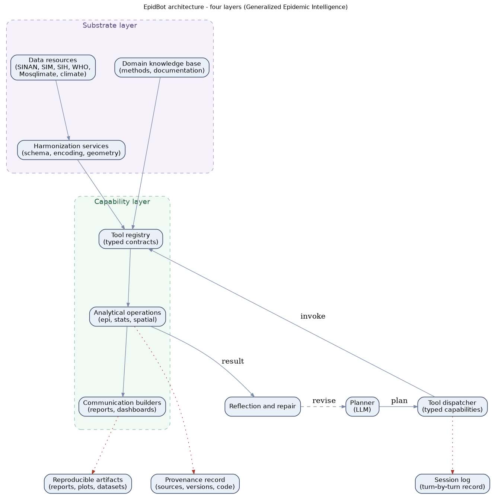

# 01. Architecture and integration

This document expands Section 4.1 of the manuscript. It describes the four layers of
the system, the reason they are kept separate, and the two design decisions that carry
most of the architectural weight: the contract-based capability layer and the
descriptor-based integration of data sources.

## The four layers

| Layer | Holds | Responsibility | What fails if it is missing |
| --- | --- | --- | --- |
| Substrate | Data resources, harmonisation services, domain knowledge base | Makes heterogeneous sources usable with a stable interface | Every analysis needs bespoke code; results are not comparable across sessions |
| Capability | Registry of typed analytical operations | Exposes what the system can do, with declared inputs and outputs | The model improvises computations in prose, and nothing can be validated |
| Orchestration | The language model, the planner, the dispatcher | Chooses a path from question to answer and supervises execution | The system becomes a fixed pipeline and cannot answer unanticipated questions |
| Accountability | Session log, provenance records, artifacts | Makes the investigation inspectable after the fact | Results cannot be audited, and reproducibility becomes a claim rather than a property |

The separation matters because each layer fails in a different way. A substrate
failure produces wrong data. A capability failure produces a refused or invalid call.
An orchestration failure produces a plausible but irrelevant analysis. An
accountability failure produces a result nobody can check. Keeping the layers distinct
makes the failure modes distinguishable, which is a precondition for the repair
strategies described in `03_orchestration.md`.

## Why the capability layer is contract based

Every operation declares six things: a name, a natural-language description of what it
does, an input schema with types and units, an output schema, its preconditions (for
instance, that a geometry table exists at the requested level), and a cost class
that indicates whether the call is cheap, expensive or long-running.

The model never invokes free-form code. It fills a schema. Three consequences follow.
Argument validation happens before execution, so a missing municipality code is caught
as a schema violation rather than as an empty result. A plan can be checked statically
before any data are read. And when a step fails, the failure is attributable to the
operation or to the argument, not to the ambiguity of a sentence.

## Integration strategy for the substrate

Sources enter the system through one of three routes. Bulk files that are published
periodically are ingested natively and versioned. Live services are reached through
adapters that normalise responses into the common table shape. Irregular sources, which
have neither a stable file layout nor an API, are ingested as files with a manual
refresh step.

Each dataset carries a descriptor: origin, licence, temporal coverage, spatial
resolution, refresh cadence, and known quality problems. The planner reads descriptors,
not raw data. This is what makes the choice of a source a documented decision. When the
requested period is not covered by the chosen source, the system reports the gap instead
of substituting a different source silently.

## What the layers deliberately do not do

The substrate does not clean silently. Any transformation that changes a value is
recorded and surfaced in the provenance record. The capability layer does not decide
which analysis is scientifically appropriate. The orchestration layer does not compute
anything itself. These three prohibitions are what keep a wrong result traceable to one
place.
