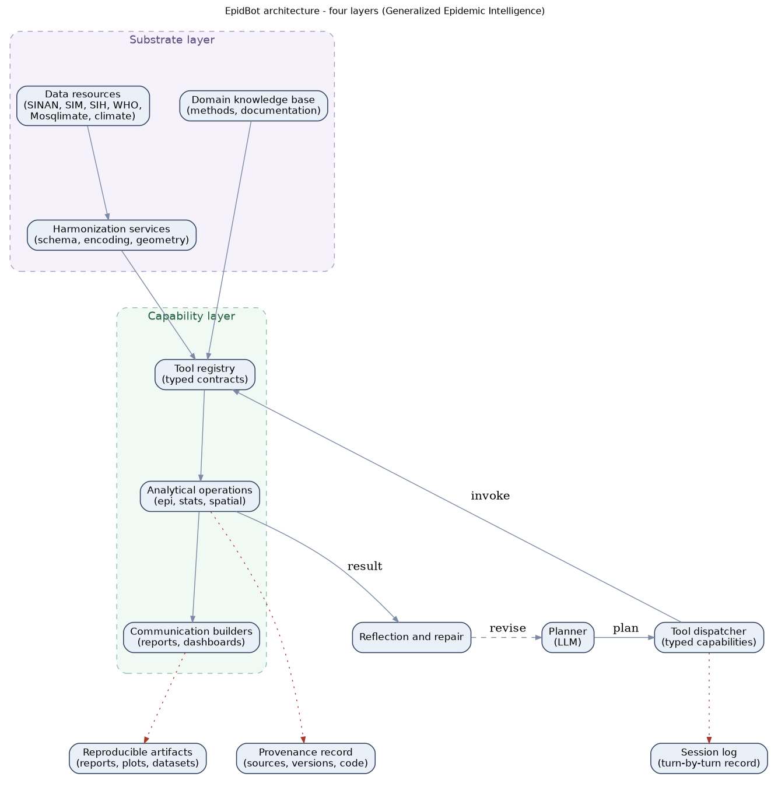

# 01. Arquitetura e integração

Este documento desenvolve a Seção 4.1 do manuscrito. Descreve as quatro camadas do
sistema, a razão de mantê-las separadas e as duas decisões de projeto que sustentam a
maior parte do peso arquitetural: a camada de capacidades baseada em contratos e a
integração de fontes de dados baseada em descritores.

## As quatro camadas

| Camada | Contém | Responsabilidade | O que falha se ela não existe |
| --- | --- | --- | --- |
| Substrato | Recursos de dados, serviços de harmonização, base de conhecimento | Torna fontes heterogêneas utilizáveis com interface estável | Toda análise exige código sob medida; resultados não são comparáveis entre sessões |
| Capacidade | Registro de operações analíticas tipadas | Expõe o que o sistema sabe fazer, com entradas e saídas declaradas | O modelo improvisa cálculos em prosa e nada pode ser validado |
| Orquestração | O modelo de linguagem, o planejador, o despachante | Escolhe o caminho entre pergunta e resposta e supervisiona a execução | O sistema vira um pipeline fixo e não responde a perguntas não previstas |
| Responsabilização | Log de sessão, registros de proveniência, artefatos | Torna a investigação inspecionável depois do fato | Resultados não podem ser auditados e a reprodutibilidade vira alegação, não propriedade |

A separação importa porque cada camada falha de modo distinto. Uma falha de substrato
produz dado errado. Uma falha de capacidade produz chamada recusada ou inválida. Uma
falha de orquestração produz análise plausível e irrelevante. Uma falha de
responsabilização produz resultado que ninguém consegue conferir. Manter as camadas
distintas torna os modos de falha distinguíveis, o que é pré-requisito para as
estratégias de reparo descritas em `03_orquestracao.md`.

## Por que a camada de capacidades é baseada em contratos

Toda operação declara seis coisas: nome, descrição em linguagem natural do que faz,
esquema de entrada com tipos e unidades, esquema de saída, pré-condições (por exemplo,
que exista tabela de geometria no nível solicitado) e classe de custo, que indica se a
chamada é barata, cara ou demorada.

O modelo nunca invoca código livre. Ele preenche um esquema. Três consequências
decorrem disso. A validação dos argumentos acontece antes da execução, então código de
município ausente é detectado como violação de esquema e não como resultado vazio. Um
plano pode ser verificado estaticamente antes de qualquer leitura de dados. E quando um
passo falha, a falha é atribuível à operação ou ao argumento, não à ambiguidade de uma
frase.

## Estratégia de integração do substrato

As fontes entram por três rotas. Arquivos publicados periodicamente são ingeridos
nativamente e versionados. Serviços ao vivo são alcançados por adaptadores que
normalizam as respostas na forma tabular comum. Fontes irregulares, que não têm layout
de arquivo estável nem API, entram como arquivos com passo de atualização manual.

Cada conjunto de dados carrega um descritor: origem, licença, cobertura temporal,
resolução espacial, cadência de atualização e problemas de qualidade conhecidos. O
planejador lê descritores, não dados brutos. É isso que transforma a escolha de uma fonte
em decisão documentada. Quando o período solicitado não é coberto pela fonte escolhida, o
sistema relata a lacuna em vez de substituir a fonte em silêncio.

## O que as camadas deliberadamente não fazem

O substrato não limpa em silêncio. Toda transformação que altera valor é registrada e
exposta no registro de proveniência. A camada de capacidades não decide qual análise é
cientificamente adequada. A camada de orquestração não calcula nada. Essas três
proibições são o que mantém um resultado errado rastreável a um único lugar.
